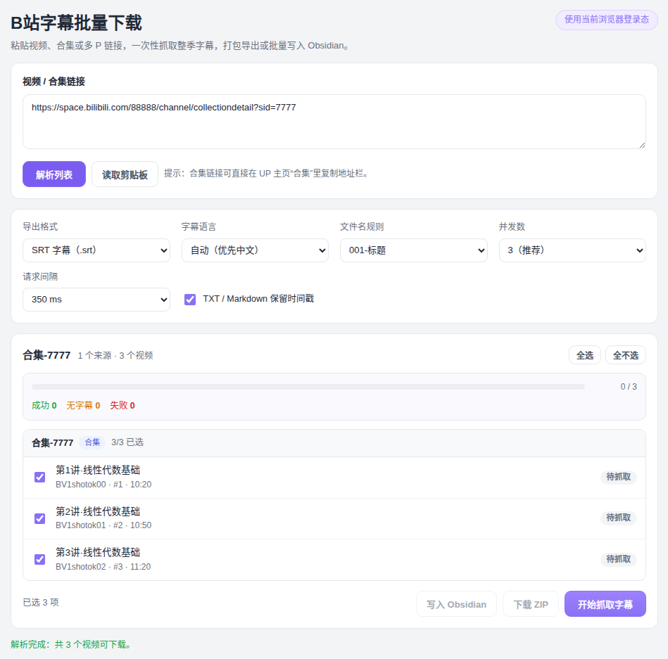
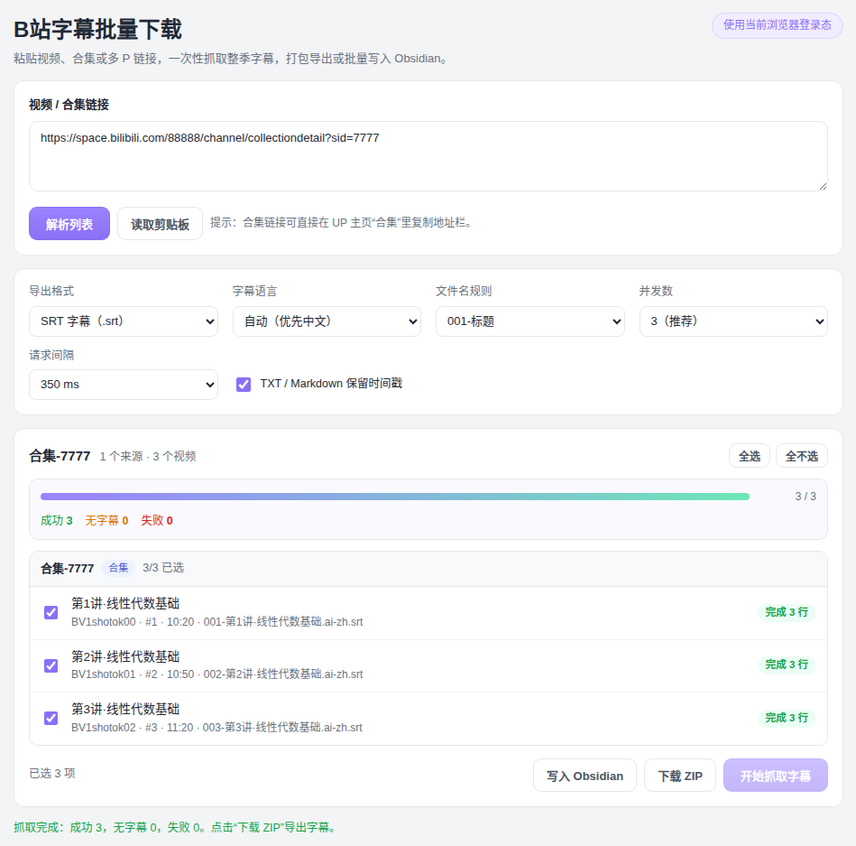

<div align="center">

# 📺 bili-subtitle-downloader

**在 B 站视频页抓取字幕 · 一键保存到 Obsidian · 整季合集批量下载**

一键抓取视频字幕为 Markdown / SRT / TXT，支持合集、多 P、收藏夹批量打包导出。
所有数据仅通过你自己的浏览器登录态获取，**不经过任何第三方服务器**。

[](https://github.com/jangviktor-web/Bilibili-Obsidian-Clipper/releases)
[](https://microsoftedge.microsoft.com/addons/detail/eabboinngmlnlleoideobkjklmdfllka)
[](https://addons.mozilla.org/zh-CN/firefox/addon/bili-subtitle-downloader/)
[](https://chromewebstore.google.com/detail/jokophbofiphenlplmohabdcmalcbenl)
[](./LICENSE)
[](./extension/manifest.json)

**安装**：[Edge 商店 ⬇](https://microsoftedge.microsoft.com/addons/detail/eabboinngmlnlleoideobkjklmdfllka) · [Firefox 商店 ⬇](https://addons.mozilla.org/zh-CN/firefox/addon/bili-subtitle-downloader/) · [离线包 ⬇](#-快速开始)

</div>

<br />

> [!NOTE]
> 仅支持获取**有字幕轨**的视频（播放器有「字幕」按钮：作者上传的外挂字幕或平台 AI 字幕）。
> AI 字幕需要登录 B 站后才能获取。

## ✨ 功能亮点

| | 功能 | 说明 |
| --- | --- | --- |
| 🎯 | **单视频抓取** | 打开视频页自动识别当前分 P，预览后复制 Markdown / 下载 SRT / TXT |
| 📚 | **合集批量下载** | UP 主合集、多 P、收藏夹、番剧一次抓完整季，`v1.2.0+` |
| 📦 | **ZIP 打包导出** | 零依赖打包（UTF-8 中文文件名），附带 `00-索引.md` 汇总表 |
| 📝 | **Markdown 笔记** | 带 frontmatter（标题 / BV 号 / UP 主 / 语言），与 Obsidian 无缝衔接 |
| 🗄 | **批量写入 Obsidian** | 复用 Local REST API 配置，同名笔记自动跳过 |
| 🛡 | **风控自适应** | 遇到 -352/-412 自动退避重试、放慢节奏，失败单条重试 |
| 🎨 | **阅读视图** | 沉浸式排版，主题 / 字号 / 行距可调，字幕同步 |
| 🤖 | **AI 侧边栏** | 围绕当前字幕对话：摘要、章节整理、带时间轴笔记 |

## 📸 界面预览

<div align="center">

**解析合集，勾选要下载的视频**



**抓取完成，逐条显示状态与导出文件名**



</div>

## 🚀 快速开始

### 安装步骤（开发者模式加载）

从 [Releases](https://github.com/jangviktor-web/Bilibili-Obsidian-Clipper/releases) 下载对应浏览器的 zip，解压后加载：

| 浏览器 | 包 | 步骤 |
| --- | --- | --- |
| Edge | [商店安装 ⬇](https://microsoftedge.microsoft.com/addons/detail/eabboinngmlnlleoideobkjklmdfllka) | Microsoft Edge 加载项商店一键安装，无需开发者模式 |
| Firefox | [商店安装 ⬇](https://addons.mozilla.org/zh-CN/firefox/addon/bili-subtitle-downloader/) | Firefox 附加组件商店一键安装，自动更新 |
| Edge（离线） | `*-edge.zip` | `edge://extensions/` → 左下角开发人员模式 → **加载解压缩的扩展**（内附 `EDGE-INSTALL.txt`） |
| Chrome | `*-chrome.zip` | `chrome://extensions/` → 开启开发者模式 → **加载已解压的扩展程序** |
| Firefox（离线） | `*-firefox.zip` | `about:addons` → 齿轮 → 调试附加组件 → **临时加载附加组件** |

> [!TIP]
> Edge 用户推荐走 [Microsoft Edge 加载项商店](https://microsoftedge.microsoft.com/addons/detail/eabboinngmlnlleoideobkjklmdfllka) 安装，Firefox 用户走 [Firefox 附加组件商店](https://addons.mozilla.org/zh-CN/firefox/addon/bili-subtitle-downloader/)，均自动更新、免开发者模式。升级时直接替换扩展目录文件并点「重新加载」，**不要先移除旧扩展**，否则设置、AI 历史和已保存的 Key 会丢失。

## 📖 使用指南

### 单视频保存

1. 打开 B 站视频页，点击扩展图标
2. 面板自动抓取并展示字幕
3. `刷新 / 复制 / 下载 / 保存到 Obsidian` 按需操作

### 批量下载（合集 / 多 P / 收藏夹）

1. 视频页点击扩展图标 → **「批量下载合集字幕」**（自动带上当前链接）
2. 粘贴链接（支持多行）→ **「解析列表」** → 勾选视频

   | 类型 | 示例 |
   | --- | --- |
   | 单视频 / 多 P | `https://www.bilibili.com/video/BVxxxx/?p=2` |
   | UP 主合集 | `https://space.bilibili.com/<mid>/channel/collectiondetail?sid=<id>` |
   | 番剧 / 课程 | `ep` 或 `ss` 链接 |
   | 收藏夹 | `https://space.bilibili.com/<mid>/favlist?fid=<id>` |

3. 选择导出格式（SRT / TXT / Markdown）、字幕语言、文件名规则、并发与间隔
4. **「开始抓取字幕」** → 等待进度完成 → **「下载 ZIP」** 或 **「写入 Obsidian」**

> [!IMPORTANT]
> 批量抓取每个视频需要 2 个请求（字幕轨道 + 字幕正文）。
> 大合集建议 **并发 1–2、间隔 800ms+**；若出现 `-352` / `-412`（风控），调低并发、等待几分钟后点「重试失败项」。66P 规模约需 5–15 分钟。

## ⚙️ Obsidian 配置

1. Obsidian 社区插件市场安装并启用 `Local REST API with MCP`
2. 插件设置勾选 `Enable Non-encrypted (HTTP) Server`
3. 复制 API Key，在扩展设置页填写 `地址`、`API Key`、`笔记目录`

批量写入路径为 `笔记目录/文件名.md`，同名笔记默认跳过不覆盖。

## ❓ FAQ

<details>
<summary><b>抓取结果显示「无字幕」？</b></summary>
<br />

该视频没有字幕轨（外挂字幕和 AI 字幕都没有）。播放器里没有「字幕」按钮的视频无法获取。

</details>

<details>
<summary><b>AI 字幕抓不到？</b></summary>
<br />

AI 字幕需要登录 B 站。请在浏览器登录后重试——扩展完全复用你自己的登录态，不会索要账号密码。

</details>

<details>
<summary><b>批量大量「失败」，错误含 <code>-352</code> / <code>-412</code>？</b></summary>
<br />

触发了 B 站风控。并发调到 1、间隔调到 1500ms，等待几分钟后点「重试失败项」。扩展遇到风控时也会自动退避重试并放慢后续请求。

</details>

<details>
<summary><b>合集里部分视频没有字幕？</b></summary>
<br />

每个视频独立判断，无字幕条目标黄显示，不影响其他视频导出。

</details>

<details>
<summary><b>ZIP 里的 <code>00-索引.md</code> 是什么？</b></summary>
<br />

导出汇总表（序号 / 标题 / BV 号 / 字幕语言 / 文件名），方便在笔记软件里建立检索索引。

</details>

## 🗂 项目结构

<details>
<summary>展开查看</summary>
<br />

```
extension/
├── manifest.json        # MV3 清单（构建时生成 Firefox 变体）
├── content.js/.css      # 视频页内面板与阅读视图
├── popup.html/.js       # 扩展弹窗（含批量下载入口）
├── background.js        # 后台：字幕抓取、Obsidian 写入、AI 代理、批量调度
├── batch-core.js        # 批量核心：链接解析、合集发现、并发队列、ZIP 打包
├── batch.html/.js/.css  # 批量下载管理页
├── sidepanel.*  ai/     # AI 侧边栏
└── options.*            # 设置页
scripts/
└── build_release.py     # 一键构建 Chrome / Edge / Firefox 发布包
```

</details>

## 🛠 开发与构建

```bash
# 构建三平台发布包（输出到 release/）
python3 scripts/build_release.py
```

- Chrome / Edge：MV3 `service_worker`，核心模块经 `importScripts` 加载
- Firefox：`background.scripts` + `sidebar_action`，自动隐藏播放器 AI 快捷按钮设置
- 本地调试：直接加载 `extension/` 目录，无需构建

<details>
<summary><b>用自己的 AI Agent 二次修改</b></summary>
<br />

1. `git clone` 或 Download ZIP 下载源码
2. 用 Cursor / Codex / Claude Code 打开项目文件夹
3. 描述想要的功能，例如「把默认保存目录改成我的 Obsidian 目录结构」「新增一个 frontmatter 属性」
4. 在扩展管理页加载 `extension/` 目录，打开 B 站视频页验证
5. 修改前保留一份原始版本，方便回退

</details>

## 📄 免责声明

> 本工具仅在用户已登录 B 站、且有访问权限的前提下获取数据。所有数据通过用户自己的浏览器和 cookie 获取，**不经过任何第三方服务器**。本工具不存储、不分发任何 B 站内容。使用本工具产生的所有后果由用户自行承担。请遵守 B 站用户协议与相关法律法规。

## 🙏 致谢

- 原项目与设计：[haixiong1997/Bilibili-Obsidian-Clipper](https://github.com/haixiong1997/Bilibili-Obsidian-Clipper)，欢迎给作者一个 Star

<div align="center">

**MIT License** · Made with ❤️ for Bilibili & Obsidian users

</div>
